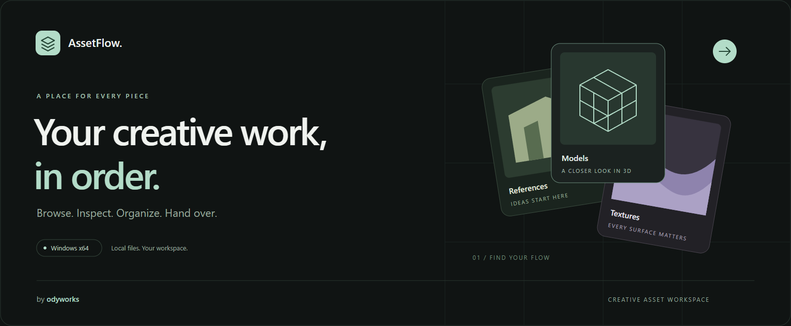
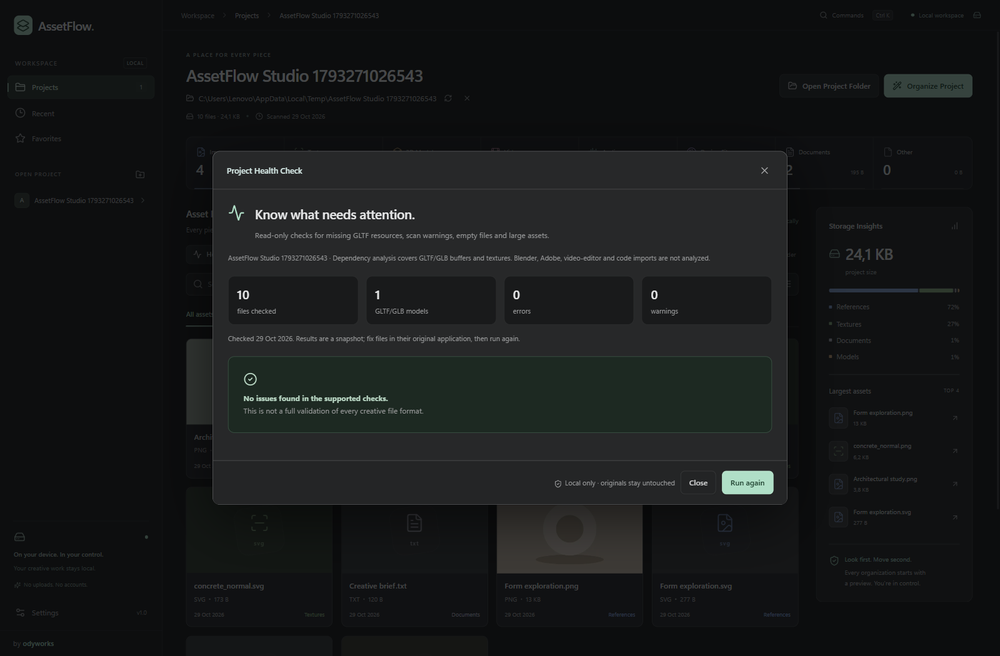
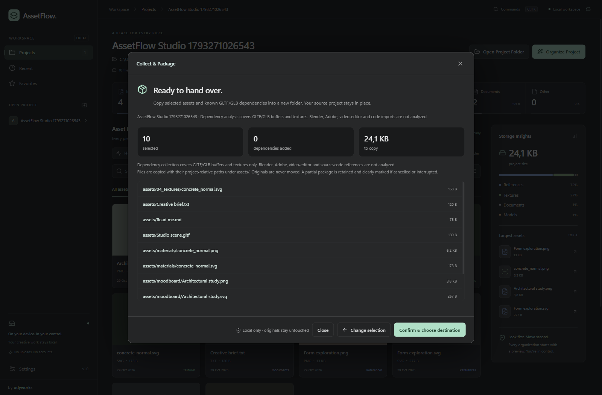

<p align="center">
  
</p>

<p align="center">
  <a href="#mulai-di-windows"><strong>Mulai gunakan ↗</strong></a> &nbsp; · &nbsp;
  <a href="docs/GUIDE.id.md">Panduan lengkap</a> &nbsp; · &nbsp;
  <a href="https://github.com/jordylf/AssetFlow/releases">Releases</a> &nbsp; · &nbsp;
  <a href="LICENSE">Lisensi MIT</a>
</p>

<p align="center">
  
  
  
  
</p>

<p align="center"><a href="README.md">English</a> &nbsp; / &nbsp; <strong>Bahasa Indonesia</strong></p>

AssetFlow mengumpulkan file di balik pekerjaan kreatifmu dalam satu workspace Windows lokal. Temukan referensi, periksa model, tinjau rencana organisasi, atau kumpulkan aset untuk diserahkan—langsung dari folder proyekmu.

Dibuat untuk **desainer, seniman 3D, editor video, dan developer**. Antarmuka aplikasi memakai bahasa Inggris; dokumentasi tersedia dalam bahasa Inggris dan Indonesia. Dibuat **by odyworks**.

## Setiap bagian proyekmu, terlihat jelas

<p align="center">
  
  <br><sub>Screenshot aplikasi Windows · proyek contoh sekali pakai · build lokal saat ini</sub>
</p>

Buka folder atau seret ke AssetFlow. Jelajahi file dalam subfolder melalui grid atau daftar, cari nama dan path, lalu filter berdasarkan kategori. Favorit mendekatkan file penting; proyek terbaru memudahkan melanjutkan pekerjaan.

Delapan statistik merangkum gambar, tekstur, model, video, audio, file desain, dokumen, serta file lainnya. **Storage Insights** menampilkan ukuran total proyek, distribusi kategori, dan empat file terbesar.

**Live folder updates** mengikuti penambahan, penyimpanan, rename, dan penghapusan file melalui notifikasi Windows. Perubahan digabung menjadi snapshot proyek dengan pencarian dan filter tetap dipertahankan. Pembaruan menunggu selama inspector atau dialog workflow terbuka. Klik **Live folder** untuk pause/resume; rescan manual tetap tersedia.

## Kenali asetmu lebih dekat

<p align="center">
  
  <br><sub>Screenshot inspector 3D · model contoh yang dibuat untuk pengujian</sub>
</p>

Pilih model **GLB atau GLTF** untuk membuka viewport studio interaktif. Orbit, pan, zoom, aktifkan grid atau wireframe, dan reset kamera. Model otomatis dibingkai dengan pencahayaan netral agar bentuknya mudah diperiksa.

Inspector melaporkan vertex, triangle, material, tekstur, dan bounding box dalam koordinat sumber. Buffer dan tekstur lokal dengan path relatif didukung, bersama decoder Draco, Meshopt, serta KTX2/Basis yang disertakan. Viewer tidak mengedit model; BLEND, FBX, dan OBJ dikenali sebagai model tetapi belum memiliki preview interaktif.

Preview gambar memiliki zoom, pan, fit, ukuran asli, dimensi, dan latar transparansi. Video serta audio diputar lokal jika codec didukung WebView2. **Open With** membuka pemilih aplikasi Windows; **ffprobe** opsional membaca metadata teknis saat diminta.

[Kontrol preview & batas format →](docs/GUIDE.id.md#preview-gambar-video-dan-audio) · [Detail inspector 3D →](docs/GUIDE.id.md#inspector-aset-3d)

## Periksa dulu. Pindahkan setelah setuju.

**Organize Project** selalu membuka pratinjau. Periksa seluruh lokasi asal dan tujuan, lalu konfirmasi secara eksplisit. Rust memvalidasi path dan menolak penggantian file yang sudah ada; nama bentrok mendapatkan akhiran angka yang aman.

```text
Proyekmu
├── 01_References    Gambar dan referensi visual
├── 02_Design        PSD · AI · FIG · XD
├── 03_Models        BLEND · GLB · GLTF · FBX · OBJ
├── 04_Textures      Gambar dengan nama yang terdeteksi sebagai tekstur
├── 05_Video         MP4 · MOV · MKV · WEBM
├── 06_Audio         WAV · MP3 · FLAC · AAC
├── 07_Exports       File yang sudah berada dalam folder ekspor ini
├── 08_Documents     PDF · TXT · DOCX · MD · RTF
└── 09_Others        Format lainnya
```

Model GLTF/GLB dan resource lokal yang diketahui tetap bersama, termasuk dependency yang dipakai beberapa model. **Undo Organization** memakai jurnal persisten dan pratinjau terpisah untuk mengembalikan organisasi terakhir. Konflik ditampilkan, bukan ditimpa.

Analisis dependency hanya mencakup GLTF/GLB. Memindahkan dependency Blender, Adobe, editor video, atau source code dapat memutus tautan; coba organisasi pada salinan dahulu. Operasi batch tidak atomik dan undo mencakup organisasi terakhir per proyek.

[Aturan klasifikasi, konflik & undo →](docs/GUIDE.id.md#organisasi-dan-keamanan-file)

## Ketahui bagian yang perlu diperiksa

<p align="center">
  
  <br><sub>Screenshot aplikasi Windows · pemeriksaan baca-saja pada proyek contoh</sub>
</p>

Jalankan **Health check** sebelum merapikan atau membagikan proyek. Fitur ini memeriksa manifest GLTF/GLB untuk buffer dan tekstur yang hilang atau tidak aman, melaporkan peringatan scan, serta menandai file kosong dan aset berukuran **512 MiB ke atas**.

Setiap error dan warning menunjukkan path beserta penjelasannya. Perbaiki sumber melalui aplikasi asal, lalu periksa ulang. Pemeriksaan mencakup metadata dan referensi yang didukung; ini bukan validator lengkap seluruh format kreatif.

## Siap diserahkan

<p align="center">
  
  <br><sub>Pratinjau paket asli · penyalinan membutuhkan konfirmasi dan lokasi tujuan</sub>
</p>

**Collect & Package** menyalin aset pilihan ke folder baru untuk diserahkan. Mulai dari filter browser aktif, tinjau pilihan, lalu AssetFlow menambahkan buffer dan tekstur GLTF/GLB yang diketahui. Dependency hilang atau tidak aman memblokir konfirmasi.

Pilih tujuan di luar folder proyek sumber. Path relatif dipertahankan di dalam `assets/`, dan `manifest.json` mencatat file salinan dengan checksum **SHA-256**. Sumber tetap utuh. Penyalinan memakai buffer streaming, dengan progres serta opsi pembatalan.

Hasil berupa **folder**, belum arsip ZIP. Pembatalan atau kegagalan menyisakan hasil parsial yang ditandai belum lengkap tanpa manifest final. Pilihan dibatasi 5.000 file dan maksimal 10.000 termasuk dependency.

Butuh ringkasan visual? **Contact sheet** mengekspor katalog HTML mandiri untuk maksimal 200 aset hasil filter, lengkap dengan thumbnail tertanam, nama, path, ukuran, serta kredit odyworks. Buka melalui browser untuk mencetak atau Save as PDF.

[Perilaku packaging →](docs/GUIDE.id.md#collect--package) · [Opsi contact sheet →](docs/GUIDE.id.md#contact-sheet)

## Cukup beberapa tombol

| Shortcut | Tindakan |
| --- | --- |
| **Ctrl + K** | Buka command palette |
| **Ctrl + O** | Buka folder proyek |
| **/** | Fokus pencarian aset |
| **Tombol panah** | Navigasi aset dan kontrol navigasi yang didukung |
| **Enter** | Periksa aset atau jalankan perintah yang difokuskan |
| **Escape** | Tutup dialog aktif atau hapus pencarian aset |
| **R** di viewport 3D | Bingkai ulang model |

Palette mencakup buka/tutup proyek, pencarian, organisasi, undo, contact sheet, health check, packaging, pergantian tampilan, dan settings. Dialog menahan fokus keyboard saat terbuka lalu memulihkannya saat ditutup; preferensi reduced motion dihormati.

## Mulai di Windows

**Versi aplikasi saat ini: 1.0.0 · Windows x64.** Paket aplikasi dibuat secara lokal; README ini tidak menganggap release unduhan sudah diterbitkan. Periksa [GitHub Releases](https://github.com/jordylf/AssetFlow/releases) untuk paket yang tersedia, atau build dari source.

| Paket | Kegunaan |
| --- | --- |
| `AssetFlow_1.0.0_x64-setup.exe` | Installer NSIS untuk pengguna Windows saat ini |
| `AssetFlow.exe` | Executable standalone |

Diperlukan Microsoft Edge **WebView2 Runtime**. Viewport 3D membutuhkan akselerasi WebGL. `ffprobe.exe` dari FFmpeg bersifat opsional, tidak disertakan, dan perlu tersedia melalui PATH untuk metadata teknis. Browser aset serta preview dasar tetap berfungsi tanpanya.

### Build dari source

Pasang Node.js **20.19+ atau 22.12+**, npm, Rust stable dengan toolchain **MSVC**, Microsoft C++ Build Tools beserta Windows SDK, dan WebView2.

```powershell
git clone https://github.com/jordylf/AssetFlow.git
cd AssetFlow
npm ci
npm run desktop
```

| Perintah | Kegunaan |
| --- | --- |
| `npm run build` | Validasi TypeScript dan frontend production |
| `npm run test:rust` | Tes klasifikasi, filesystem, watcher, dan workflow |
| `npm run desktop:build` | Executable optimal dan installer NSIS |
| `npm run sample` | Buat proyek contoh baru di Windows Temp |
| `npm run bench` | Ukur build release dengan fixture sekali pakai; membutuhkan Playwright |

Executable: `src-tauri/target/release/assetflow.exe`. Installer: `src-tauri/target/release/bundle/nsis/`. `npm run dev` di browser tidak menyediakan operasi folder native.

## Filemu tetap milikmu

Tanpa akun, cloud sync, layanan AI, atau database. Operasi file berlangsung lokal. Scan hanya membaca; organisasi memerlukan konfirmasi eksplisit. Tidak ada operasi hapus file dan file tujuan yang sudah ada tidak pernah ditimpa.

Thumbnail memakai cache encoded 32 MiB, maksimal tiga pekerjaan bersamaan, dan pemuatan dekat viewport. Inspector 3D dimuat sesuai kebutuhan dan melepaskan resource saat ditutup. Watcher memakai notifikasi tanpa polling saat idle; packaging memakai chunk streaming 128 KiB. Penggunaan resource tetap bergantung pada ukuran proyek, decoding sumber, GPU, dan fitur aktif—ini bukan jaminan batas RAM tetap.

[Hasil pengukuran performa & setup pengujian →](docs/PERFORMANCE.md)

## Dibangun untuk kerja lokal

| Lapisan | Teknologi / tanggung jawab |
| --- | --- |
| Desktop | Tauri 2 · dialog Windows · WebView2 |
| Antarmuka | React 19 · TypeScript · Tailwind CSS · Lucide · Framer Motion |
| 3D | React Three Fiber · Three.js · decoder lokal |
| Filesystem | Rust · validasi path · preview pemindahan · jurnal undo |
| Workflow | Watcher native notify · health check · paket streaming SHA-256 |

[Panduan pengguna & developer](docs/GUIDE.id.md) · [English guide](docs/GUIDE.md) · [Roadmap](docs/BACKLOG.md) · [Sumber visual](docs/SHOWCASE.md)

## Kontribusi

Laporkan bug melalui [GitHub Issues](https://github.com/jordylf/AssetFlow/issues) dengan versi aplikasi/Windows, langkah reproduksi, serta pesan error terkait. Gunakan contoh sekali pakai, bukan aset pribadi klien. Jalankan `npm run build`, `npm run test:rust`, dan pemeriksaan native yang relevan sebelum mengusulkan perubahan.

## Lisensi & kredit

[Lisensi MIT](LICENSE) · © 2026 Jordy Lian Ferdinand (**odyworks**). Dependensi pihak ketiga tetap memiliki lisensinya masing-masing. Artwork cover dibuat khusus; screenshot aplikasi serta konten contohnya dijelaskan dalam [Sumber visual](docs/SHOWCASE.md).
