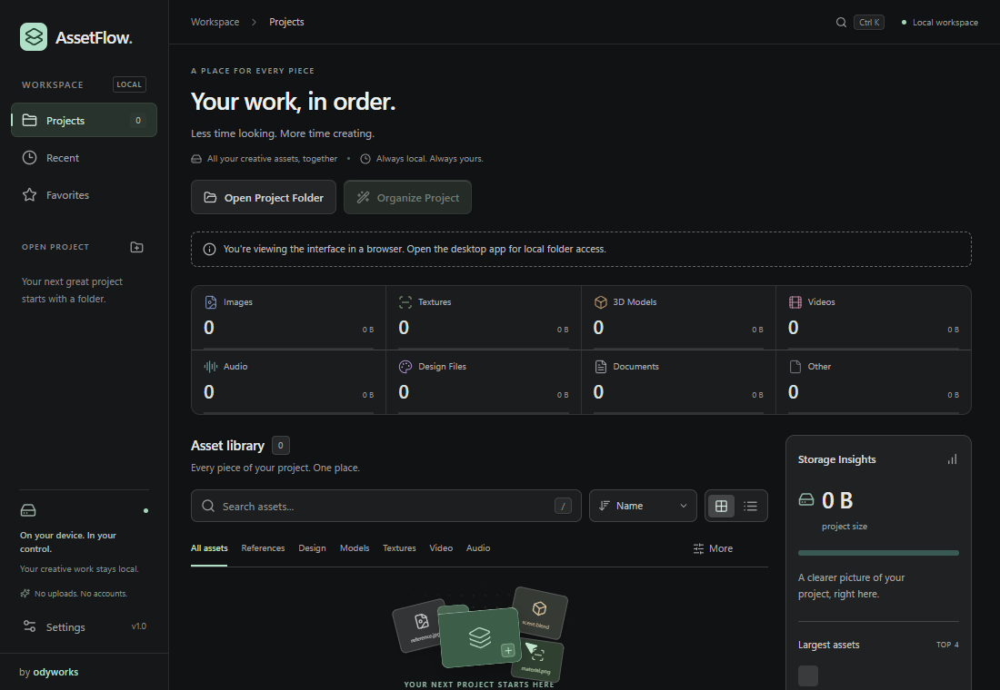
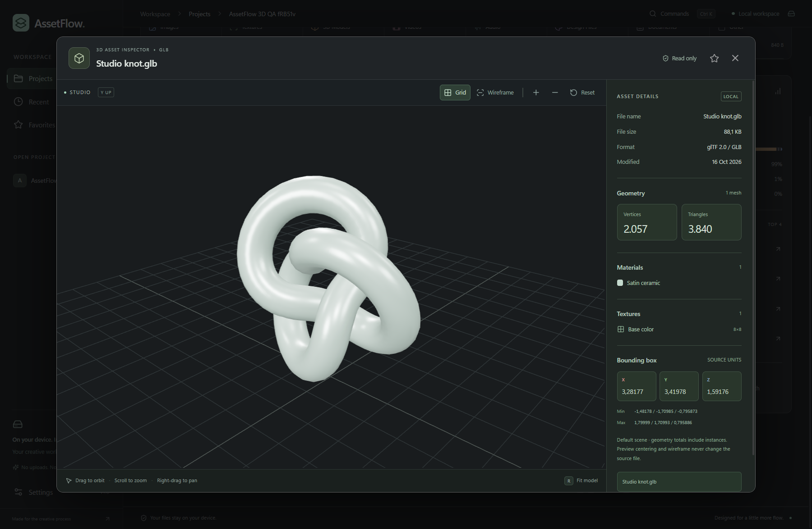

# AssetFlow

**Karya kreatifmu, lebih tertata.** Aplikasi desktop Windows untuk menjelajahi, memeriksa, dan merapikan file proyek desainer, seniman 3D, editor video, serta developer. Dibuat **by odyworks**.

[English](README.md) · **Bahasa Indonesia**

Dibangun dengan Tauri 2, Rust, React, TypeScript, Tailwind CSS, Lucide, Framer Motion, React Three Fiber, dan Three.js. Seluruh pengelolaan aset berjalan lokal melalui antarmuka gelap yang ringkas dan mendukung navigasi keyboard. Antarmuka aplikasi saat ini menggunakan bahasa Inggris; dokumentasi tersedia dalam dua bahasa.



## Fitur utama

| Fitur | Kegunaan |
| --- | --- |
| Impor proyek | Buka atau seret folder ke aplikasi desktop; pindai file secara rekursif tanpa mengubahnya. |
| Browser aset | Tampilan grid/daftar, thumbnail yang didukung, filter kategori, serta pengurutan nama, ukuran, dan tanggal perubahan. |
| Pencarian | Cari berdasarkan nama file, path, ekstensi, atau kategori. |
| Statistik proyek | Jumlah gambar, tekstur, model, video, audio, file desain, dokumen, serta file lain. |
| Storage Insights | Ukuran total proyek, distribusi kategori berdasarkan byte, dan empat aset terbesar. |
| Favorit dan proyek terbaru | Tandai aset dan buka kembali proyek dengan preferensi yang disimpan lokal. |
| Pratinjau organisasi | Periksa lokasi asal dan tujuan seluruh file sebelum menyetujui pemindahan. |
| Penanganan nama bentrok | File tidak ditimpa; nama bentrok mendapat akhiran angka. |
| Inspector 3D | Viewport GLB/GLTF dengan pencahayaan studio, kontrol kamera, dan metadata. |
| Command palette | Ctrl+K untuk membuka enam tindakan umum melalui keyboard. |

Tidak ada autentikasi, sinkronisasi cloud, fitur AI, atau database. Isi file tetap berada di perangkatmu. Internet diperlukan untuk mengunduh dependensi pengembangan; penelusuran, inspeksi, dan organisasi aset berjalan lokal.

## Instalasi Windows

Target build saat ini adalah Windows x64. Jika paket aplikasi sudah diterbitkan, unduh melalui [GitHub Releases](https://github.com/jordylf/AssetFlow/releases):

- `AssetFlow_1.0.0_x64-setup.exe`: instal untuk pengguna Windows saat ini.
- `AssetFlow.exe`: jalankan aplikasi standalone secara langsung.

Diperlukan Microsoft Edge WebView2 Runtime. Inspector 3D juga membutuhkan akselerasi perangkat keras WebGL. Jika belum ada release, gunakan panduan build dari source di bawah. Hasil kompilasi diabaikan Git; salinan paket lokal dapat disimpan di `release/`.

## Menjalankan dari source

Persyaratan pengembangan:

- Node.js 20.19+ atau 22.12+ dan npm untuk Vite 7.
- Rust stable dengan toolchain MSVC.
- Microsoft Visual Studio C++ Build Tools dan Windows SDK.
- WebView2 Runtime pada Windows x64.

```powershell
git clone https://github.com/jordylf/AssetFlow.git
cd AssetFlow
npm ci
npm run desktop
```

Launcher juga mencari Rust di direktori `.cargo/bin` default pengguna. Aset decoder disiapkan otomatis sebelum pengembangan frontend dan build.

| Perintah | Kegunaan |
| --- | --- |
| `npm run desktop` | Jalankan aplikasi native dalam mode pengembangan |
| `npm run dev` | Preview antarmuka di browser pada `http://127.0.0.1:1420` |
| `npm run build` | Pemeriksaan TypeScript dan build frontend produksi |
| `npm run test:rust` | Tes klasifikasi, keamanan filesystem, dan isolasi resource model |
| `npm run desktop:build` | Build executable native dan installer NSIS |
| `npm run sample` | Buat proyek contoh baru di direktori sementara sistem |

Operasi folder native membutuhkan aplikasi desktop; preview browser hanya menyediakan antarmuka.

Hasil build:

```text
src-tauri/target/release/assetflow.exe
src-tauri/target/release/bundle/nsis/AssetFlow_1.0.0_x64-setup.exe
```

## Cara menggunakan

1. Jalankan aplikasi, lalu klik **Open Project Folder** atau seret folder ke jendela AssetFlow.
2. Tunggu pemindaian selesai. Periksa peringatan jika ada file atau folder yang tidak bisa dibaca.
3. Cari aset berdasarkan nama/path, filter kategori atau tipe file, lalu urutkan berdasarkan nama, ukuran, atau waktu perubahan.
4. Pilih **Grid View** untuk penelusuran visual atau **List View** untuk tampilan daftar.
5. Pilih aset untuk melihat metadata. File GLB/GLTF membuka inspector 3D; aset lain membuka detail file.
6. Tandai bintang untuk favorit atau gunakan **Show in File Explorer** untuk menemukan file asal.
7. Klik **Organize Project** untuk membuat pratinjau. **Cancel** tidak memindahkan file; **Confirm Organization** menjalankan rencana.

Path proyek terbaru, favorit, preferensi tampilan, dan pengaturan thumbnail disimpan dalam penyimpanan lokal WebView. Gambar raster yang didukung browser memiliki thumbnail; format lainnya memakai ikon. Storage Insights menampilkan ukuran total, distribusi kategori berdasarkan byte, serta empat file terbesar.

## Klasifikasi file

| Kategori | Format / aturan | Folder tujuan |
| --- | --- | --- |
| References / Images | PNG, JPG, JPEG, WEBP, TIFF, TIF, TGA, EXR, HDR, GIF, BMP, AVIF, SVG | `01_References` |
| Design | PSD, AI, FIG, XD | `02_Design` |
| Models | BLEND, GLB, GLTF, FBX, OBJ | `03_Models` |
| Textures | Gambar dengan nama yang mengandung kata kunci tekstur | `04_Textures` |
| Video | MP4, MOV, MKV, WEBM | `05_Video` |
| Audio | WAV, MP3, FLAC, AAC | `06_Audio` |
| Exports | File yang sudah berada dalam `07_Exports` | `07_Exports` |
| Documents | PDF, TXT, DOCX, MD, RTF | `08_Documents` |
| Other | Format lainnya, termasuk source code developer | `09_Others` |

Ekstensi dan nama dicocokkan tanpa membedakan huruf besar/kecil. Kata kunci tekstur: `normal`, `roughness`, `metallic`, `metalness`, `albedo`, `diffuse`, `height`, `displacement`, `ao`, `ambient_occlusion`, `specular`, dan `opacity`. Pencocokan memakai substring, sehingga kata pendek `ao` bisa cocok dengan nama yang sebenarnya tidak berkaitan dengan tekstur. File yang sudah berada dalam `07_Exports` tetap masuk Exports.

Klasifikasi tidak berarti semua format memiliki editor atau preview bawaan. Preview 3D interaktif saat ini hanya mendukung GLB dan GLTF.

## Organisasi dan keamanan file

**Organize Project tidak langsung memindahkan file.** Backend memindai ulang proyek dan menyimpan rencana pemindahan. Tombol konfirmasi mengirim ID rencana ke Rust, bukan path bebas dari antarmuka.

```text
Sebelum                        Sesudah
materials/wood_albedo.png  ->   04_Textures/wood_albedo.png
drafts/interface.fig       ->   02_Design/interface.fig
reference/photo.jpg        ->   01_References/photo.jpg
```

File dalam subfolder diratakan ke folder kategorinya. Jika nama tujuan sudah ada, dibuat nama aman seperti `wood_albedo_01.png`. File yang sudah terorganisasi tetap di tempatnya. Folder kosong tidak dihapus.

Perlindungan yang diterapkan:

- Pemindaian hanya membaca file dan melewati symbolic link, junction, serta reparse point lain.
- Peringatan pemindaian perlu diselesaikan sebelum organisasi dijalankan.
- Rust memvalidasi batas proyek, ukuran/waktu perubahan file asal, serta tujuan sebelum memindahkan.
- Windows memakai `MoveFileExW` tanpa opsi penggantian, sehingga file tujuan tidak tertimpa meskipun muncul setelah pratinjau dibuat.
- Tidak tersedia operasi penghapusan file.
- Pratinjau yang sudah tidak sesuai harus dibuat ulang. Kesalahan ditampilkan kepada pengguna.

**Batasan proyek yang saling terhubung:** organisasi tidak memperbarui referensi antarfile. Memindahkan GLTF dari buffer `.bin` atau teksturnya, dependensi Blender, media video, maupun file yang diimpor source code dapat memutus referensi. Coba organisasi pada cadangan atau proyek contoh terlebih dahulu. GLB dengan seluruh dependensi tertanam lebih mudah diorganisasi.

Satu batch bukan transaksi filesystem. Jika pemindahan gagal di tengah proses, file yang sebelumnya berhasil dipindahkan tetap di lokasi baru; aplikasi melaporkan jumlah keberhasilan dan kesalahan. Tidak ada rollback atau undo otomatis. Validasi metadata bukan pemeriksaan hash isi file. Tutup aplikasi yang sedang aktif mengubah file sebelum mengonfirmasi organisasi.

## Inspector aset 3D



Pilih file `.glb` atau `.gltf` untuk membuka inspector React Three Fiber / Three.js yang dimuat saat diperlukan.

- Orbit melalui drag, pan melalui klik kanan dan drag, serta zoom melalui scroll atau tombol.
- Model otomatis dipusatkan dan dibingkai dengan pencahayaan studio netral.
- Tombol grid, wireframe, serta reset kamera.
- Nama file, ukuran, format, tanggal perubahan, dan path asal.
- Jumlah vertex dan triangle, material, tekstur beserta dimensi gambar, serta minimum/maksimum/dimensi bounding box.

Jumlah geometri berasal dari mesh pada scene default, termasuk instance. Model ditampilkan dalam pose statis; kamera dan lampu sumber tidak menggantikan studio. Bounding box menggunakan koordinat asal model, terpisah dari preview yang dipusatkan. Perubahan kamera, pencahayaan, dan wireframe tidak menulis perubahan ke model atau material di disk.

Resource tertanam dalam GLB, data URI, dan buffer/tekstur GLTF dengan path relatif didukung. Path dapat mengarah ke folder saudara selama masih di dalam proyek, termasuk nama dengan percent encoding. Rust memvalidasi semua resource terhadap folder proyek dan menolak path keluar proyek, junction, symbolic link, URL jarak jauh, serta referensi absolut.

Decoder Draco, Meshopt, dan KTX2/Basis disertakan secara lokal tanpa CDN. Resource hilang atau tidak valid menampilkan kesalahan dengan opsi mencoba ulang. Viewport merender sesuai kebutuhan dan melepaskan geometri, material, tekstur, image bitmap, serta worker decoder saat ditutup.

Batasnya 512 MiB per resource lokal dan total 768 MiB resource sumber yang dimuat per model. Ini merupakan viewer; pengeditan model, kontrol pemutaran animasi, dan preview interaktif BLEND/FBX/OBJ belum tersedia. Referensi GLTF harus tetap valid setelah pemindahan file.

## Shortcut keyboard

| Shortcut | Tindakan |
| --- | --- |
| Ctrl+K | Buka command palette |
| Ctrl+O | Buka folder proyek |
| `/` | Fokus pencarian ketika tidak mengetik di kolom lain |
| Atas / Bawah dalam palette | Navigasi perintah yang cocok |
| Enter | Jalankan perintah atau periksa aset yang difokuskan |
| Tombol panah | Navigasi kartu/baris aset, sidebar, kategori, dan statistik yang didukung |
| Home / End | Fokus aset pertama / terakhir |
| Bawah dari pencarian | Masuk ke kumpulan aset |
| Escape | Tutup dialog aktif atau hapus pencarian aset |
| R saat viewport 3D fokus | Bingkai ulang/reset kamera |
| Tombol panah saat viewport 3D fokus | Geser kamera |

Perintah palette: **Open Project**, **Search Assets**, **Organize Project**, **Grid View**, **List View**, dan **Open Settings**. Organize Project tetap membuka pratinjau konfirmasi. Fokus keyboard ditahan dalam dialog saat terbuka dan dipulihkan setelah ditutup. Preferensi sistem untuk mengurangi animasi dihormati.

## Pemeriksaan UI opsional

Playwright disediakan oleh lingkungan pengembangan, bukan dependensi aplikasi. Instal dengan `npm install --no-save --package-lock=false playwright`, atau arahkan `ASSETFLOW_PLAYWRIGHT` ke path paket yang sudah tersedia. Mode browser memakai Microsoft Edge. Saat `npm run dev` berjalan, jalankan `node scripts/ui-smoke.cjs`.

Untuk pemeriksaan native, build terlebih dahulu dan gunakan instance pengujian terpisah:

```powershell
$env:WEBVIEW2_USER_DATA_FOLDER = Join-Path $env:TEMP ('AssetFlow-QA-' + [guid]::NewGuid())
$env:WEBVIEW2_ADDITIONAL_BROWSER_ARGUMENTS = '--remote-debugging-port=9223'
Start-Process -FilePath '.\src-tauri\target\release\assetflow.exe' -WindowStyle Hidden
$env:ASSETFLOW_CDP = 'http://127.0.0.1:9223'
# Tunggu jendela pengujian siap, lalu jalankan berurutan.
node scripts/model-smoke.cjs
node scripts/ui-smoke.cjs
```

Script menggunakan proyek fixture, termasuk organisasi yang dikonfirmasi. Gunakan instance terpisah, bukan sesi kerja aktif. Screenshot disimpan dalam `test-results/` yang diabaikan Git. Hapus variabel WebView2 sementara atau gunakan terminal baru untuk menjalankan aplikasi secara normal.

## Arsitektur

- `src/App.tsx`: state proyek, filter, favorit, preferensi, dan interaksi aplikasi.
- `src/components/`: Sidebar, ProjectHeader, StatCard, AssetGrid, AssetList, AssetCard, SearchBar, OrganizationPreview, StorageInsights, EmptyState, dialog, dan inspector.
- `src/types.ts`: tipe Asset, Project, AssetCategory, MoveOperation, dan tipe pendukung.
- `src/lib/filesystem.ts`: batas command Tauri bertipe dan pemilih folder native.
- `src/lib/keyboard.ts`: helper navigasi keyboard.
- `src/lib/format.ts`: helper tampilan dan kategori.
- `src/lib/model.ts`: pemuatan GLTF/GLB, decoder, metadata, pemusatan, dan pelepasan resource.
- `src-tauri/src/filesystem.rs`: klasifikasi, scan, rencana, validasi path, pemindahan tanpa overwrite, dan tes keamanan.
- `src-tauri/src/model.rs`: pembacaan resource model dengan batas ukuran dan tes isolasi path.
- `src-tauri/src/lib.rs`: command async, sesi proyek, rencana organisasi, dan konfigurasi keamanan worker.
- `scripts/desktop.mjs`: launcher toolchain desktop.
- `scripts/copy-decoders.mjs`: menyiapkan decoder lokal dan worker Basis statis.
- `docs/images/`: screenshot dokumentasi.

Frontend meminta operasi melalui command Tauri; Rust mengelola akses filesystem dan rencana organisasi. Three.js dimuat secara lazy. Worker Basis mendapat CSP terbatas untuk kebutuhan runtime-nya tanpa akses jaringan, sementara antarmuka utama tetap memblokir `unsafe-eval`.

## Kontribusi dan kepemilikan

Laporan bug sebaiknya menyertakan versi aplikasi, versi Windows, langkah reproduksi, dan pesan kesalahan terkait. Gunakan proyek contoh yang aman dibagikan, bukan aset pribadi. Sebelum mengusulkan perubahan kode, jalankan `npm run build` dan `npm run test:rust`, ditambah pemeriksaan native yang relevan untuk perubahan filesystem atau viewer.

Dibuat **by odyworks**. Repositori ini belum memberikan lisensi open source; status public saja tidak memberikan izin untuk mendistribusikan ulang atau menggunakan kembali kode. Dependensi pihak ketiga tetap mengikuti lisensinya masing-masing.
