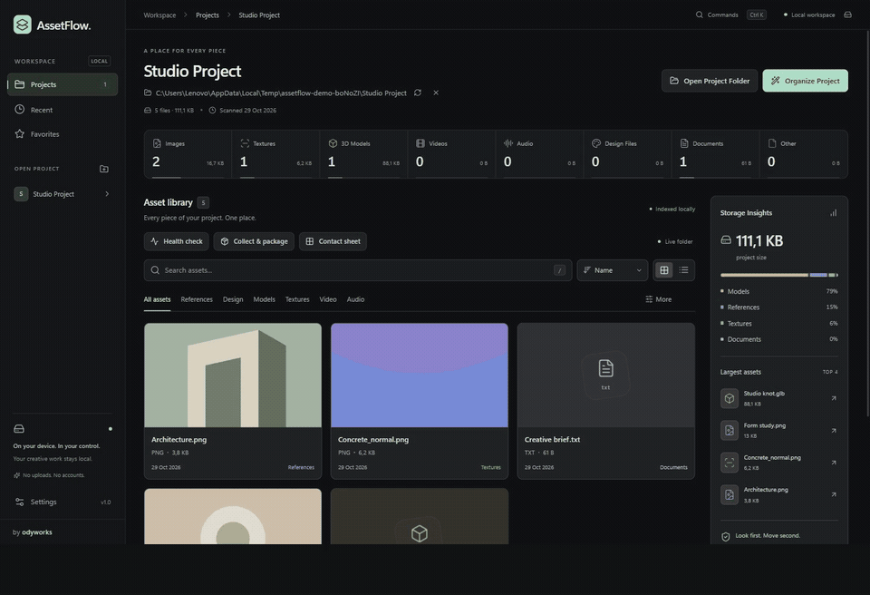

<p align="center">
  
</p>

<p align="center">
  <a href="https://github.com/jordylf/AssetFlow/releases/download/v1.0.0/AssetFlow_1.0.0_x64-setup.exe"><strong>Download for Windows ↗</strong></a> &nbsp; · &nbsp;
  <a href="docs/GUIDE.md">User guide</a> &nbsp; · &nbsp;
  <a href="https://github.com/jordylf/AssetFlow/releases">Releases</a> &nbsp; · &nbsp;
  <a href="LICENSE">MIT license</a>
</p>

<p align="center">
  
  
  
  
</p>

<p align="center"><strong>English</strong> &nbsp; / &nbsp; <a href="README.id.md">Bahasa Indonesia</a></p>

AssetFlow brings the files behind your creative work into one local Windows workspace. Find a reference, inspect a model, review an organization plan, or collect assets for handoff—without leaving your project folder behind.

Built for **designers, 3D artists, video editors, and developers**. The app interface is in English; documentation is available in English and Indonesian. Crafted **by odyworks**.

## See it in action

[](https://github.com/jordylf/AssetFlow/releases/download/v1.0.0/AssetFlow-demo.mp4)

22-second native-app tour · silent · disposable sample content. Browsing, search, 3D inspection, organization preview, confirmation on a sample, and health check.

[Watch / download the MP4](https://github.com/jordylf/AssetFlow/releases/download/v1.0.0/AssetFlow-demo.mp4) · [Version 1.0.0 release notes](docs/releases/1.0.0.md)

## Every piece of your project, in view

<p align="center">
  
  <br><sub>Actual Windows app capture · disposable sample project · current local build</sub>
</p>

Open a folder or drop it into AssetFlow. Browse nested files in a compact grid or list, search by filename and path, and filter by category. Favorites keep useful files close; recent projects let you pick up where you left off.

Eight statistics summarize images, textures, models, video, audio, design files, documents, and other assets. **Storage Insights** shows total project size, category shares, and the four largest files.

**Live folder updates** follow creations, saves, renames, and removals through native Windows notifications. Changes are batched into project snapshots, preserving your search and filters. Updates wait while an inspector or workflow dialog is open. Pause or resume with **Live folder**; manual rescan remains available.

## Get closer to the asset

<p align="center">
  
  <br><sub>Actual 3D inspector capture · generated sample model</sub>
</p>

Select a **GLB or GLTF** model for an interactive studio viewport. Orbit, pan, zoom, toggle the grid or wireframe, and reset the camera. Automatic framing puts the model in view; neutral lighting makes its form readable.

The inspector reports vertices, triangles, materials, textures, and source-space bounds. Local relative buffers and textures are supported, with bundled Draco, Meshopt, and KTX2/Basis decoders. The viewer does not edit the model; BLEND, FBX, and OBJ are classified but do not have an interactive preview.

Images have zoom, pan, fit, actual size, dimensions, and a transparency checkerboard. Video and audio use local playback when WebView2 supports their codecs. **Open With** opens the Windows application chooser; optional **ffprobe** reads technical metadata on demand.

[Preview controls & format limits →](docs/GUIDE.md#image-video-and-audio-preview) · [3D inspector details →](docs/GUIDE.md#3d-asset-inspector)

## Look first. Move second.

**Organize Project** always opens a preview. Review every source and destination, then confirm explicitly. Rust validates paths and refuses replacement of existing files; name collisions receive safe numbered suffixes.

```text
Your project
├── 01_References    Images and visual references
├── 02_Design        PSD · AI · FIG · XD
├── 03_Models        BLEND · GLB · GLTF · FBX · OBJ
├── 04_Textures      Images detected by texture filenames
├── 05_Video         MP4 · MOV · MKV · WEBM
├── 06_Audio         WAV · MP3 · FLAC · AAC
├── 07_Exports       Files already inside this export folder
├── 08_Documents     PDF · TXT · DOCX · MD · RTF
└── 09_Others        Remaining file types
```

GLTF/GLB models and their known local resources stay together, including shared dependencies. **Undo Organization** uses a persistent journal and a separate preview to restore the last organization. Conflicts are shown rather than overwritten.

Only GLTF/GLB dependencies are analyzed. Moving Blender, Adobe, video-editor, or source-code dependencies can break links; try organization on a copy first. Batches are not atomic, and undo covers the most recent organization per project.

[Classification rules, conflict handling & undo →](docs/GUIDE.md#organization-and-safety)

## Know what needs attention

<p align="center">
  
  <br><sub>Actual Windows app capture · read-only checks on sample content</sub>
</p>

Run **Health check** before organizing or sharing. It checks GLTF/GLB manifests for missing or unsafe buffer and texture references, reports scan warnings, and flags empty files and assets of **512 MiB or more**.

Errors and warnings include the affected path and an explanation. Fix the source in its original application, then run again. This checks supported metadata and references; it is not a full creative-file validator.

## Ready to hand over

<p align="center">
  
  <br><sub>Actual package preview · copying requires confirmation and a destination</sub>
</p>

**Collect & Package** copies selected assets into a new folder for handoff. Start from the current browser filters, review the selection, and let AssetFlow add known GLTF/GLB buffers and textures. Missing or unsafe dependencies block confirmation.

Choose a destination outside the source project. Relative paths stay intact under `assets/`, and `manifest.json` records the copied files with **SHA-256 checksums**. Originals remain untouched. Copies use a streaming buffer; progress and cancellation are available.

The result is a **folder**, not a ZIP archive. A cancelled or failed operation retains clearly marked partial output without a complete manifest. Selection is limited to 5,000 files and 10,000 including dependencies.

Need a visual overview instead? **Contact sheet** exports a standalone HTML catalog for up to 200 filtered assets, with embedded thumbnails, names, paths, sizes, and the odyworks credit. Open it in a browser to print or save as PDF.

[Packaging behavior →](docs/GUIDE.md#collect--package) · [Contact sheet options →](docs/GUIDE.md#contact-sheets)

## A few keys away

| Shortcut | Action |
| --- | --- |
| **Ctrl + K** | Open the command palette |
| **Ctrl + O** | Open a project folder |
| **/** | Focus asset search |
| **Arrow keys** | Navigate assets and supported navigation controls |
| **Enter** | Inspect the focused asset or run a command |
| **Escape** | Close the active dialog or clear asset search |
| **R** in the 3D viewport | Reframe the model |

The palette includes opening and closing projects, searching, organizing, undo, contact sheets, health checks, packaging, view switching, and settings. Dialogs contain keyboard focus and restore it on close; reduced-motion preferences are respected.

## Start on Windows

**Latest release: [1.0.0](https://github.com/jordylf/AssetFlow/releases/tag/v1.0.0) · Windows x64.** Download the installer or standalone executable below. Packages are unsigned; local execution was verified on Windows 11.

| Package | Purpose |
| --- | --- |
| [AssetFlow_1.0.0_x64-setup.exe](https://github.com/jordylf/AssetFlow/releases/download/v1.0.0/AssetFlow_1.0.0_x64-setup.exe) | NSIS installer for the current Windows user |
| [AssetFlow.exe](https://github.com/jordylf/AssetFlow/releases/download/v1.0.0/AssetFlow.exe) | Standalone executable |

[SHA-256 checksums](https://github.com/jordylf/AssetFlow/releases/download/v1.0.0/SHA256SUMS.txt) · [Release notes & limitations](docs/releases/1.0.0.md)

Microsoft Edge **WebView2 Runtime** is required. The 3D viewport needs WebGL hardware acceleration. FFmpeg's `ffprobe.exe` is optional, is not bundled, and must be available through PATH for technical metadata. Ordinary browsing and previews work without it.

### Build from source

Install Node.js **20.19+ or 22.12+**, npm, stable Rust with the **MSVC** toolchain, Microsoft C++ Build Tools with a Windows SDK, and WebView2.

```powershell
git clone https://github.com/jordylf/AssetFlow.git
cd AssetFlow
npm ci
npm run desktop
```

| Command | Purpose |
| --- | --- |
| `npm run build` | TypeScript validation and production frontend |
| `npm run test:rust` | Classification, filesystem, watcher, and workflow tests |
| `npm run desktop:build` | Optimized executable and NSIS installer |
| `npm run sample` | Create a new disposable project in Windows Temp |
| `npm run bench` | Measure a release build with disposable fixtures; requires Playwright |

Executable: `src-tauri/target/release/assetflow.exe`. Installer: `src-tauri/target/release/bundle/nsis/`. Browser-only `npm run dev` does not provide native folder operations.

## Your files stay yours

No accounts, cloud sync, AI services, or database. File operations run locally. Scanning is read-only; organization requires explicit confirmation. There is no file-delete operation, and existing destination files are never overwritten.

Thumbnails use a 32 MiB encoded cache, at most three concurrent jobs, and loading near the viewport. The 3D inspector loads on demand and releases its resources on close. Watcher notifications replace idle polling; packaging streams through 128 KiB chunks. Resource use still depends on project size, source decoding, GPU, and active features—these are not fixed RAM guarantees.

[Measured performance & test setup →](docs/PERFORMANCE.md)

## Built for local work

| Layer | Technology / responsibility |
| --- | --- |
| Desktop | Tauri 2 · Windows dialogs · WebView2 |
| Interface | React 19 · TypeScript · Tailwind CSS · Lucide · Framer Motion |
| 3D | React Three Fiber · Three.js · bundled local decoders |
| Filesystem | Rust · path validation · previewed moves · undo journal |
| Workflows | Native notify watcher · health checks · streaming SHA-256 packages |

[Complete user & developer guide](docs/GUIDE.md) · [Indonesian guide](docs/GUIDE.id.md) · [Roadmap](docs/BACKLOG.md) · [Visual sources](docs/SHOWCASE.md)

## Contribute

Report bugs through [GitHub Issues](https://github.com/jordylf/AssetFlow/issues) with your app/Windows versions, reproduction steps, and relevant errors. Use disposable samples rather than private client assets. Run `npm run build`, `npm run test:rust`, and relevant native checks before proposing changes.

## License & credits

[MIT License](LICENSE) · © 2026 Jordy Lian Ferdinand (**odyworks**). Third-party dependencies retain their own licenses. Cover artwork is original; app captures and their sample content are documented in [Visual sources](docs/SHOWCASE.md).

If AssetFlow helps your workflow, consider **starring the repository**. Feedback and reproducible bug reports are welcome too.
